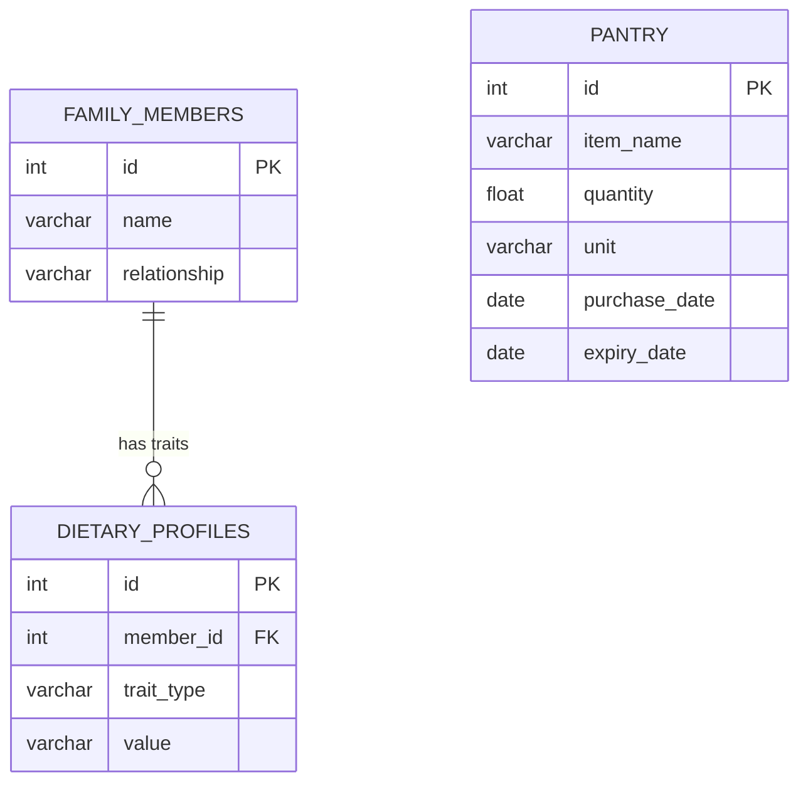
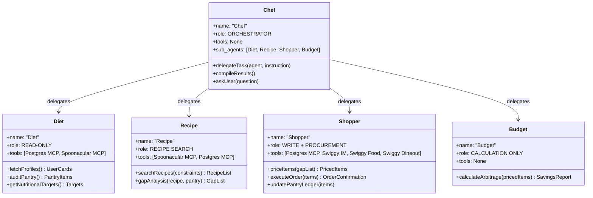
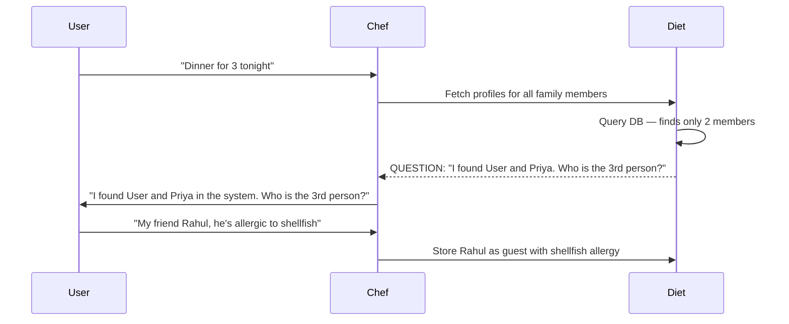
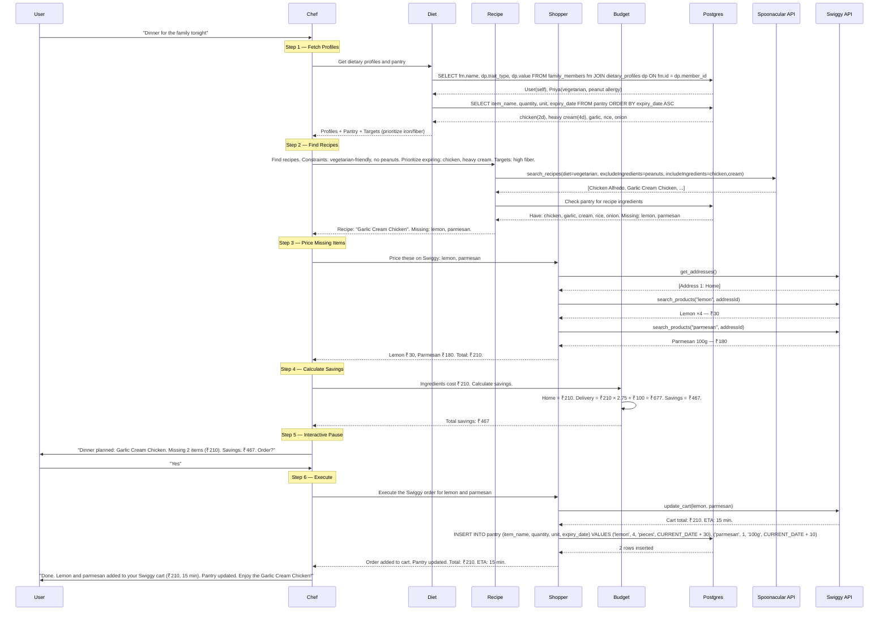
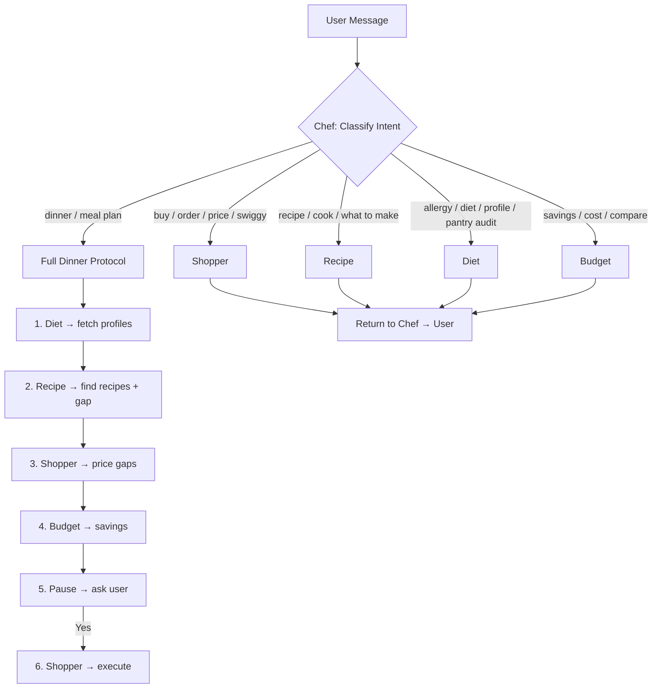
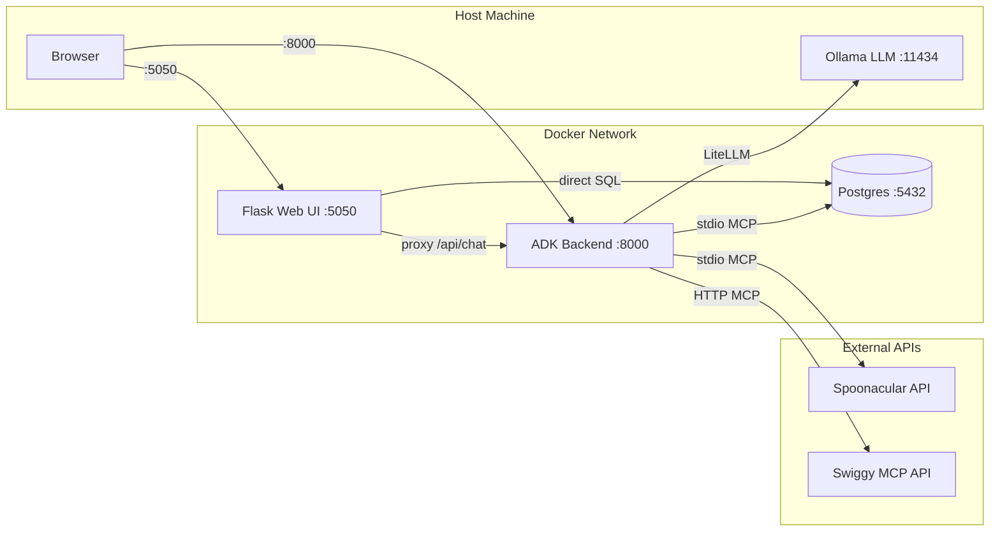

# KitchenOS Pipeline Architecture

> Complete software lifecycle document — from user types and stories through API surface, data model, agent hierarchy, and runtime execution.

---

## 1. User Types & Permissions

| User Type | Role | Capabilities |
|---|---|---|
| **Owner** | Head of Household | Full DB access, financial thresholds, guest approval, order execution |
| **Member** | Family Resident | Update personal "Card" (preferences/allergies), trigger meal plans, add to cart |
| **Guest** | Transient Profile | Read-only preference injection for a single session (e.g., dinner party) |

### Permission Matrix

| Action | Owner | Member | Guest |
|---|---|---|---|
| Trigger meal plan | ✅ | ✅ | ❌ |
| Update dietary profile | ✅ | ✅ (own only) | ❌ |
| Modify pantry | ✅ | ✅ | ❌ |
| Approve Swiggy order | ✅ | ❌ | ❌ |
| View pantry / profiles | ✅ | ✅ | ✅ (session only) |

---

## 2. User Stories

### US-01: The Family Dinner
> "As an Owner, I want to say 'Dinner for the family tonight' and have the system plan a meal that respects everyone's dietary constraints, identify missing ingredients, price them on Swiggy, and tell me my savings — so I only need to say 'Yes' to order."

**Acceptance Criteria:**
- Dietary profiles fetched from Postgres (not assumed)
- Recipe sourced from Spoonacular (not hardcoded)
- Missing items priced on Swiggy Instamart
- Savings calculated (home cooking vs. delivery)
- User must explicitly approve before any order executes

### US-02: Pantry Audit
> "As a Member, I want to ask 'What's expiring soon?' and get a sorted list of pantry items by expiry date."

**Acceptance Criteria:**
- Data comes from `pantry` table only
- Sorted by `expiry_date ASC`
- Items expiring within 3 days flagged

### US-03: Price Check
> "As an Owner, I want to ask 'What's the price of milk?' and get the current Swiggy Instamart price without placing any order."

**Acceptance Criteria:**
- Shopper agent searches Swiggy Instamart
- Returns price and availability
- No cart modification or order placement

### US-04: Profile Management
> "As a Member, I want to tell the system 'Priya is allergic to peanuts' and have it update the database."

**Acceptance Criteria:**
- Shopper agent inserts into `dietary_profiles`
- Confirmation via SELECT back

### US-05: Zero-Waste Cooking
> "As a Member, I want the system to suggest recipes that prioritize expiring ingredients so that I minimize food waste."

**Acceptance Criteria:**
- Diet agent fetches expiring items from pantry
- Recipe agent filters Spoonacular results to maximize use of those items

---

## 3. API Surface

### 3.1 ADK Backend (Port 8000)

These are the Google ADK endpoints the Web UI proxies through:

| Method | Endpoint | Description |
|---|---|---|
| `POST` | `/apps/head_chef/users/{user_id}/sessions` | Create a new chat session |
| `POST` | `/run_sse` | Send a message and stream the agent response via SSE |
| `GET` | `/debug/trace/session/{session_id}` | Debug trace for a session |

**SSE Payload (POST `/run_sse`):**
```json
{
  "app_name": "head_chef",
  "user_id": "user",
  "session_id": "<uuid>",
  "new_message": {
    "role": "user",
    "parts": [{ "text": "Dinner for the family tonight" }]
  },
  "streaming": false
}
```

**SSE Response Stream:**
Each line is `data: <json>`. The relevant fields:
```json
{
  "author": "Chef",
  "content": {
    "parts": [{ "text": "..." }]
  }
}
```

### 3.2 Web UI Backend (Port 5050)

| Method | Endpoint | Description |
|---|---|---|
| `GET` | `/` | Landing page |
| `GET` | `/chat` | Chat interface |
| `POST` | `/api/session` | Proxy: creates ADK session, returns `{ session_id }` |
| `POST` | `/api/chat` | Proxy: forwards message to ADK `/run_sse`, streams response |
| `GET` | `/api/pantry` | Direct DB: returns pantry items as JSON |
| `GET` | `/api/family` | Direct DB: returns family members + dietary traits |
| `GET` | `/api/schema` | Direct DB: returns table/column definitions from `information_schema` |

### 3.3 MCP Endpoints (Internal)

| MCP Server | Transport | Endpoint / Command |
|---|---|---|
| Spoonacular | stdio | `npx -y spoonacular-mcp` |
| Postgres | stdio | `npx -y mcp-postgres` |
| Swiggy Instamart | Streamable HTTP | `https://mcp.swiggy.com/im` |
| Swiggy Food | Streamable HTTP | `https://mcp.swiggy.com/food` |
| Swiggy Dineout | Streamable HTTP | `https://mcp.swiggy.com/dineout` |

---

## 4. Data Model

### Entity-Relationship Diagram



### Table Details

**`family_members`**
| Column | Type | Constraint |
|---|---|---|
| `id` | `SERIAL` | PRIMARY KEY |
| `name` | `VARCHAR(100)` | NOT NULL |
| `relationship` | `VARCHAR(50)` | NOT NULL — `self`, `spouse`, `child`, `parent` |

**`dietary_profiles`**
| Column | Type | Constraint |
|---|---|---|
| `id` | `SERIAL` | PRIMARY KEY |
| `member_id` | `INT` | FK → `family_members(id)` ON DELETE CASCADE |
| `trait_type` | `VARCHAR(20)` | CHECK: `allergy`, `diet`, `dislike`, `favorite` |
| `value` | `VARCHAR(100)` | NOT NULL |

**`pantry`**
| Column | Type | Constraint |
|---|---|---|
| `id` | `SERIAL` | PRIMARY KEY |
| `item_name` | `VARCHAR(100)` | NOT NULL |
| `quantity` | `FLOAT` | DEFAULT 1 |
| `unit` | `VARCHAR(30)` | DEFAULT `'unit'` |
| `purchase_date` | `DATE` | DEFAULT `CURRENT_DATE` |
| `expiry_date` | `DATE` | NULL = non-perishable |

### Seed Data

```sql
-- Family
INSERT INTO family_members (name, relationship) VALUES
    ('User', 'self'), ('Priya', 'spouse');

-- Dietary Profiles
INSERT INTO dietary_profiles (member_id, trait_type, value) VALUES
    (2, 'diet', 'vegetarian'), (2, 'allergy', 'peanuts');

-- Pantry
INSERT INTO pantry (item_name, quantity, unit, purchase_date, expiry_date) VALUES
    ('chicken breast', 2, 'pieces', CURRENT_DATE - 1, CURRENT_DATE + 2),
    ('garlic', 5, 'cloves', CURRENT_DATE - 7, CURRENT_DATE + 21),
    ('heavy cream', 1, 'carton', CURRENT_DATE - 3, CURRENT_DATE + 4),
    ('rice', 2, 'kg', CURRENT_DATE - 30, CURRENT_DATE + 335),
    ('onion', 4, 'pieces', CURRENT_DATE - 5, CURRENT_DATE + 9);
```

---

## 5. Agent Hierarchy (UML Class Diagram)



### Key Design Constraints

| Constraint | Rationale |
|---|---|
| Chef has **zero tools** | Prevents the orchestrator from bypassing agents and accessing data directly |
| Diet is **read-only** | Separation of concerns — only Shopper can write to the DB |
| Recipe uses **only Spoonacular** for recipes | Recipes must come from a verified culinary API, not hallucinated |
| Sub-agents **never talk to the user** | All clarification flows through Chef to maintain a single conversational thread |
| Budget has **zero tools** | Pure function — takes numbers in, returns savings out |

---

## 6. Communication Protocol

### Question Forwarding Pattern

When a sub-agent lacks information, it does **not** ask the user. Instead:



### Rules

1. **No agent-to-user communication** — only Chef speaks to the user
2. **No assumptions** — if data is missing, ask (don't default)
3. **Questions propagate upward** — sub-agent → Chef → user → Chef → sub-agent

---

## 7. Runtime Execution: The Family Dinner Protocol

### Full Sequence Diagram



---

## 8. Agent Routing Logic

When a user message arrives, the Chef routes it based on intent:



---

## 9. Infrastructure & Deployment

### Docker Compose Topology



### Container Specifications

| Container | Image | Port | Depends On |
|---|---|---|---|
| `mychef-postgres` | `postgres:15-alpine` | 5432 | — |
| `mychef-app` | Custom (Python 3.11 + Node 20) | 8000 | Postgres (healthy) |
| `mychef-web` | Custom (Python 3.11) | 5050 | ADK + Postgres |

---

## 10. Safety & Guardrails

| Rule | Enforcement | Location |
|---|---|---|
| **No actual Swiggy checkout** | Hard-coded in Shopper instruction: "NEVER place an actual order" | `prompts.py` |
| **Diet is read-only** | Instruction says "Never use INSERT, UPDATE, or DELETE" | `prompts.py` |
| **Chef has no tools** | `tools=[]` in agent definition | `agent.py` |
| **No agent-to-user talk** | All sub-agent instructions say "return question to Chef" | `prompts.py` |
| **No hallucinated recipes** | Recipe agent must use Spoonacular MCP exclusively | `prompts.py` |
| **No default assumptions** | Chef instruction: "Do not assume generic defaults" | `prompts.py` |

---

## 11. Testing Matrix

| Test File | What It Verifies | Count |
|---|---|---|
| `test_agent.py` | Agent hierarchy, names, tools, parent relationships | 23 |
| `test_ollama.py` | Ollama reachability, model availability, LiteLLM routing | 4 |
| `test_mcps.py` | Spoonacular MCP launch, Postgres MCP launch, Swiggy MCP connection | 4 |

### Test Commands

```bash
# All tests
PYTHONPATH=. pytest tests/ -v

# Agent structure only
PYTHONPATH=. pytest tests/test_agent.py -v

# Verify Spoonacular is connected
PYTHONPATH=. pytest tests/test_mcps.py::test_spoonacular_mcp_starts_and_lists_tools -v

# Verify Postgres is connected
PYTHONPATH=. pytest tests/test_mcps.py::test_postgres_mcp_starts_and_lists_tools -v

# Verify Swiggy is connected
PYTHONPATH=. pytest tests/test_mcps.py::test_swiggy_mcp_starts_and_lists_tools -v

# Verify LLM works end-to-end
PYTHONPATH=. pytest tests/test_ollama.py::test_litellm_completion_to_ollama -v
```
